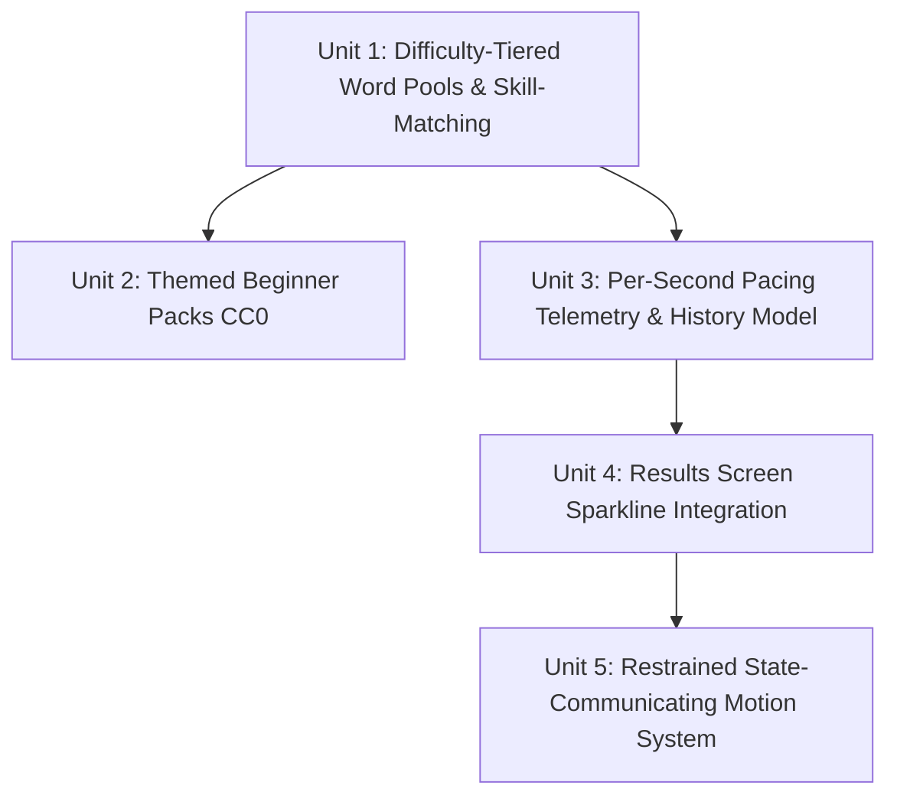

# Goldmine Master Programme — Typing Experience Improvement Plan

> **Status:** Proposal (Unit 0 — Plan Only)  
> **Target:** Master typing experience upgrade across 4 core workstreams  
> **Guardrails:** Lighthouse 95+ preserved · Sub-100ms keystroke feel inviolable · Strict monochrome design system  

---

## Executive Summary & Architecture Guardrails

The **Goldmine** programme elevates the core typing engine from a functional speed-test utility to an Apple/Linear-grade typing craft experience. It addresses four foundational workstreams:
1. **Difficulty-tiered word pools** (beginner → advanced lists, matched to skill).
2. **Themed beginner packs** (animals, food, nature — CC0 sources from dariusk/corpora).
3. **Per-second WPM capture + sparkline on the results screen** (granular pacing telemetry + pure SVG visualization).
4. **Restrained motion that communicates state only** (~200–350ms, state transitions, reduced-motion safe).

### Non-Negotiable Engineering Guardrails
1. **Sub-100ms Keystroke Feel:** The fast-path keystroke handler (`handleKeydown` / direct character evaluation) has zero allocations, zero DOM queries, zero transitions, and zero telemetry overhead. Telemetry runs at 1Hz on the animation frame timer loop.
2. **Lighthouse 95+ Preserved:** Zero external graphing or animation libraries. No runtime API calls. Word banks are static, deduplicated TypeScript arrays (<8KB total gzipped). Sparklines are pure inline SVG.
3. **Monochrome Design System:** All new components strictly inherit the established dark/light tokens (`--bg`, `--surface`, `--text-primary`, `--text-secondary`, `--border`) with the single existing accent (`#0072F5`). Themed packs are linguistic themes, never rainbow color palettes.
4. **Client-Side i18n Rule:** Follows the repo's client-side DOM replacement pattern (`data-i18n` attributes, never static strings passed as props).

---

## Programme Breakdown: 5 Discrete Units

---

### Unit 1: Difficulty-Tiered Word Pools & Skill Matching

#### Purpose
Introduce a structured 3-tier vocabulary ladder (Beginner, Intermediate, Advanced) and an optional skill-matching recommendation based on the user's assessed skill band.

#### Exact Files Touched
- `src/data/wordbanks.ts`
- `src/components/TypingEngine.astro`
- `src/utils/metrics.ts`
- `src/i18n/en.json` (and corresponding locale files: `es.json`, `fr.json`, `de.json`, `pt.json`, `it.json`, `ja.json`, `ko.json`)

#### What It Changes
1. **Curated Advanced Vocabulary Pool:** Add `ADVANCED_WORDS: string[]` in [src/data/wordbanks.ts](file:///c:/my%20things/instanttyping.com/src/data/wordbanks.ts) (~250–300 words). Features polysyllabic words, academic vocabulary, challenging affixes, and irregular orthography (*ephemeral, idiosyncratic, juxtaposition, subterranean, ubiquitous, labyrinthine, pragmatic*). Deduplicated, clean lowercase, no archaic trivia or slurs.
2. **Beginner Pool Refinement:** Polish `BEGINNER_WORDS` into a clean phonetic and physical progression (home-row anchors → clean 3-to-5 letter common words).
3. **Skill-Matching Helper:** Export `getRecommendedTier(wpm: number): 'beginner' | 'intermediate' | 'advanced'` in [src/utils/metrics.ts](file:///c:/my%20things/instanttyping.com/src/utils/metrics.ts), mapping Starting/Developing (<40 WPM) → Beginner, Intermediate (40–79 WPM) → Intermediate, Advanced/Elite (80+ WPM) → Advanced.
4. **UI Selector Options:** Update `#wordbank-select` in [src/components/TypingEngine.astro](file:///c:/my%20things/instanttyping.com/src/components/TypingEngine.astro) with:
   - `top200` / `intermediate`: Standard Vocabulary (Top 200/1000)
   - `advanced`: Advanced Vocabulary
   - `auto`: Auto (Match Skill) — dynamically selects tier using the user's historical average WPM from `localStorage`.
5. **i18n Keys:** Add `options.corpus_advanced` ("Advanced Vocabulary") and `options.corpus_auto` ("Auto (Match Skill)") across all locale files.

#### What It Explicitly Does NOT Touch
- Keystroke critical loop (`handleKeydown`, `handleInput`).
- Caret animation and DOM layout.
- Quote mode, classics passages, and code snippets.
- Audio synthesis and volume controls.

#### Risk Assessment
- **Lighthouse (95+):** 🟢 **Zero risk.** Adds ~3KB of static text data compiled ahead of time. No dynamic dependencies.
- **Sub-100ms Typing Feel:** 🟢 **Zero risk.** Words are selected strictly on test initialization or reset; zero execution during active typing.
- **Monochrome Design System:** 🟢 **Zero risk.** Standard `<option>` items inside existing monochrome select control.

---

### Unit 2: Themed Beginner Packs (Curated CC0 Corpora)

#### Purpose
Provide engaging, relatable beginner packs (Animals, Food, Nature/Space) sourced from Public Domain / CC0 datasets (dariusk/corpora) to make touch-typing enjoyable and concrete for early-stage typists.

#### Exact Files Touched
- `src/data/themed-packs.ts` *(new file)*
- `src/components/TypingEngine.astro`
- `src/i18n/en.json` (and locale files)

#### What It Changes
1. **New Static Module `themed-packs.ts`:**
   - Sourced from CC0 dariusk/corpora datasets:
     - `ANIMALS_PACK`: ~120 words (mammals, birds, marine life — e.g. *otter, falcon, badger, dolphin, sparrow*).
     - `FOOD_PACK`: ~120 words (fruits, vegetables, bakery, cooking — e.g. *apricot, basil, cinnamon, ginger, pretzel*).
     - `NATURE_SPACE`: ~120 words (trees, weather, cosmos, geography — e.g. *glacier, comet, willow, canyon, nebula*).
   - Strict CC0 provenance headers and clean ASCII lowercase tokens (length 3–9 chars).
2. **Engine Integration:**
   - Wire `theme-animals`, `theme-food`, and `theme-nature` into `getSelectedCorpus()` in [src/components/TypingEngine.astro](file:///c:/my%20things/instanttyping.com/src/components/TypingEngine.astro).
   - Group them under a clean `<optgroup label="Themed Beginner Packs">` inside `#wordbank-select`.
3. **i18n Keys:**
   - Add `options.corpus_theme_animals` ("Animals"), `options.corpus_theme_food` ("Food & Cooking"), `options.corpus_theme_nature` ("Nature & Space").

#### What It Explicitly Does NOT Touch
- Existing language word banks (`es`, `fr`, `de`, `pt`, `it`).
- Typing test layout or word-wrap mechanisms.
- Results calculation logic or XP scoring rules.

#### Risk Assessment
- **Lighthouse (95+):** 🟢 **Zero risk.** Small static bundle (~3KB gzipped), tree-shakeable.
- **Sub-100ms Typing Feel:** 🟢 **Zero risk.** Selected once per test start.
- **Monochrome Design System:** 🟢 **Zero risk.** Pure typographic text in standard JetBrains Mono font. Strictly avoids playful emojis or colorful badges in the UI.

---

### Unit 3: Per-Second Pacing Telemetry & History Capture

#### Purpose
Capture authentic second-by-second pacing telemetry (instantaneous per-second cadence in addition to cumulative WPM) and persist it into the local test history model for longitudinal pacing analysis.

#### Exact Files Touched
- `src/components/TypingEngine.astro`
- `src/utils/metrics.ts`

#### What It Changes
1. **Instantaneous vs. Cumulative Telemetry:**
   - Currently, `secondBySecondWpm` only logs cumulative average WPM (`interimMetrics.netWpm`), which heavily dampens bursts and slowdowns.
   - Update `runTimerLoop` in [src/components/TypingEngine.astro](file:///c:/my%20things/instanttyping.com/src/components/TypingEngine.astro) to sample at each integer second:
     - Delta characters typed in that specific second: `deltaChars = correctKeystrokes - lastSecCorrectChars`.
     - Instantaneous slice WPM: `Math.max(0, Math.round((deltaChars / 5) * 60))`.
     - Store both instantaneous cadence and cumulative curve.
2. **Telemetry Persistence:**
   - Update `TestHistoryEntry` interface in [src/utils/metrics.ts](file:///c:/my%20things/instanttyping.com/src/utils/metrics.ts) to optionally include `wpmHistory?: number[]`.
   - In `saveTestResult()`, cap `wpmHistory` length (e.g., maximum 180 points for a 3-minute test) to prevent `localStorage` quota bloat.
3. **Completed Test Summary Payload:**
   - Expose `wpmHistory` and `instantaneousWpm` on `CompletedTestSummary` for consumption by the results screen and coaching card.

#### What It Explicitly Does NOT Touch
- Keystroke event listeners (`keydown` and `input`). Telemetry code runs exclusively on the 1-second boundary tick inside `runTimerLoop`.
- Existing `calculateMetrics()` Net WPM / Accuracy formulas.
- LocalStorage structure compatibility (entry fields are optional/additive; historical tests without `wpmHistory` load seamlessly).

#### Risk Assessment
- **Lighthouse (95+):** 🟢 **Zero risk.** No DOM changes, no layout recalculations.
- **Sub-100ms Typing Feel:** 🟡 **Low risk (mitigated).** Executing arithmetic inside `runTimerLoop` could cause jank if done every frame. **Mitigation:** The delta calculation is guarded by `if (currentSecInt > lastSecondRecorded)` so it runs exactly ONCE every 1,000ms, completely decoupled from keystroke inputs.
- **Monochrome Design System:** 🟢 **N/A.** Logic and data persistence layer.

---

### Unit 4: Results Screen Sparkline Integration (Monochrome SVG)

#### Purpose
Wire the existing standalone, pure-SVG sparkline component ([src/scripts/sparkline.ts](file:///c:/my%20things/instanttyping.com/src/scripts/sparkline.ts) and [src/styles/sparkline.css](file:///c:/my%20things/instanttyping.com/src/styles/sparkline.css)) into the results screen to provide an immediate, elegant visual representation of test pacing and rhythm stability.

#### Exact Files Touched
- `src/components/TypingEngine.astro`
- `src/scripts/sparkline.ts`
- `src/styles/sparkline.css`
- `src/styles/global.css`

#### What It Changes
1. **Results Screen Sparkline Placement:**
   - Embed a compact sparkline slot `

` in the **Net Speed** primary KPI card in [src/components/TypingEngine.astro](file:///c:/my%20things/instanttyping.com/src/components/TypingEngine.astro).
   - Alternatively, mount directly above the detailed timeline chart as a micro-summary strip.
2. **Wiring in `showResults()`:**
   - Import `renderSparkline` from `../scripts/sparkline`.
   - In `showResults()`, invoke `renderSparkline(sparklineEl, secondBySecondWpm, { width: 220, height: 48, animate: true, endDot: true })`.
3. **Monochrome Styling & Reduced Motion:**
   - Ensure [src/styles/sparkline.css](file:///c:/my%20things/instanttyping.com/src/styles/sparkline.css) is properly imported in [src/styles/global.css](file:///c:/my%20things/instanttyping.com/src/styles/global.css).
   - Inherit `currentColor` (`#0072F5` for Net Speed card, or neutral `--text-primary`), 6% fill area opacity, and zero-animation immediate draw on `(prefers-reduced-motion: reduce)`.
4. **Accessible Semantics:**
   - Provide dynamic `aria-label` ("WPM pacing curve: started at 45 WPM, peaked at 78 WPM, finished at 72 WPM").

#### What It Explicitly Does NOT Touch
- The active typing area or caret during the test.
- The 500x100 detailed interactive timeline chart with crosshairs (`timeline-chart-svg`).
- No addition of external chart libraries (Chart.js, D3, Canvas).

#### Risk Assessment
- **Lighthouse (95+):** 🟢 **Zero risk.** Renders ~10 SVG elements inside a DOM node that is hidden until test completion. Zero impact on initial page load LCP/FCP/CLS.
- **Sub-100ms Typing Feel:** 🟢 **Zero risk.** Renders only in `showResults()` after test completion.
- **Monochrome Design System:** 🟡 **Medium risk (mitigated).** Charts often tempt developers to introduce multi-color gradients. **Mitigation:** Strictly adhere to `currentColor` stroke with 0.06 opacity area fill, matching the existing monochrome design tokens.

---

### Unit 5: Restrained State-Communicating Motion System

#### Purpose
Implement the repository's restrained motion rules (~200–350ms, state changes and attention-guiding only, reduced-motion safe) to eliminate abrupt layout snaps and calm auxiliary interface distractions during active typing.

#### Exact Files Touched
- `src/styles/global.css` (or dedicated `src/styles/typing-motion.css`)
- `src/components/TypingEngine.astro`

#### What It Changes
1. **Focus Calming State (`test-active`):**
   - When the user starts typing (first valid keystroke), add an `.engine-running` state to the container.
   - Auxiliary controls (toolbar buttons, corpus dropdown, settings gear, footer nav links) gently dim to `opacity: 0.35` over 250ms using `--spring` (`cubic-bezier(0.32, 0.72, 0, 1)`), eliminating peripheral distraction.
   - On test pause or completion, opacity gently restores over 200ms.
2. **Corpus & Wordbank Crossfade:**
   - When the user switches difficulty tier or wordbank, apply a subtle 180ms text crossfade to `#words-wrapper` so new words don't snap abruptly into view.
3. **Results Reveal Smoothing:**
   - Replace the abrupt `classList.remove("hidden")` layout jump with a smooth 300ms spring reveal on `#results-panel`, coordinating the card cascade without layout thrashing.
4. **Full `prefers-reduced-motion` Enforcement:**
   - All motion rules have strict `@media (prefers-reduced-motion: reduce)` overrides (`transition: none !important; animation: none !important; opacity: 1 !important;`).

#### What It Explicitly Does NOT Touch
- **Typing Caret & Letter Rendering:** Strictly **NO** CSS transitions on letters (`.char-correct`, `.char-incorrect`) or caret coordinates during active typing. These must remain 0ms instantaneous hardware-accelerated transforms.
- Visual theme colors or brand tokens.
- Audio synthesis or key sound triggers.

#### Risk Assessment
- **Lighthouse (95+):** 🟢 **Zero risk.** Pure CSS transitions on GPU-accelerated properties (`opacity`, `transform`). No continuous JavaScript rAF animation loops.
- **Sub-100ms Typing Feel:** 🔴 **Critical risk (mitigated).** If any CSS transition is accidentally placed on `.typing-caret` or `.word-char`, keystroke latency will immediately spike above 100ms and feel sluggish. **Mitigation:** Strict exclusion list. Only container opacity and modal entrance use transitions; active typing DOM elements are permanently transition-free.
- **Monochrome Design System:** 🟢 **Zero risk.** Uses opacity changes against existing background colors without adding hue shifts.

---

## Unit Dependency & Risk Matrix

| Unit | Name | Files Touched | Primary Risk | Mitigation |
| :--- | :--- | :--- | :--- | :--- |
| **Unit 1** | Difficulty-Tiered Word Pools | `wordbanks.ts`, `TypingEngine.astro`, `metrics.ts`, `en.json` | Bundle size creep | Curated static arrays (<3KB gzipped), no external dictionaries. |
| **Unit 2** | Themed Beginner Packs (CC0) | `themed-packs.ts`, `TypingEngine.astro`, `en.json` | Aesthetic dilution | Strict monochrome JetBrains Mono text; zero emoji or cartoon styling. |
| **Unit 3** | Per-Second Telemetry Capture | `TypingEngine.astro`, `metrics.ts` | Timer loop lag | Computed strictly on 1Hz integer second boundary, never on keydown. |
| **Unit 4** | Results Screen Sparkline | `TypingEngine.astro`, `sparkline.ts`, `sparkline.css`, `global.css` | Color styling creep | Pure SVG inheriting `currentColor`, zero-dependency, reduced-motion bypass. |
| **Unit 5** | Restrained State Motion | `global.css`, `TypingEngine.astro` | Keystroke latency spike | Active typing spans and caret are strictly forbidden from having CSS transitions. |

---

## Verification & Acceptance Protocol

For each unit during implementation:
1. `npm run test` must pass (all unit tests green).
2. `npm run build` must complete with zero TypeScript or Astro compiler errors.
3. Manual verification of sub-100ms typing feel: rapid burst typing (120+ WPM) produces instant, lag-free caret and character responses.
4. Mobile and desktop viewport responsiveness preserved.
5. Strict `prefers-reduced-motion: reduce` verification (all animations bypass immediately to static states).
6. Clean git tree at each step — zero unapproved file modifications.
